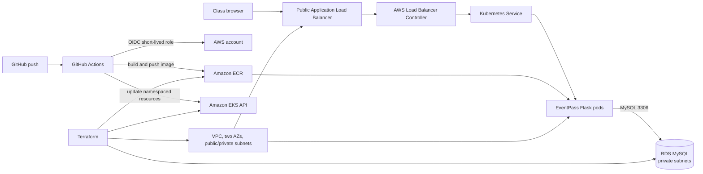
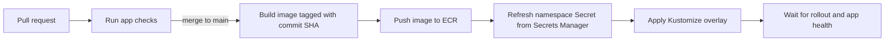

# EventPass architecture and rollout plan

## Target runtime

The control plane is AWS managed. Terraform creates the VPC, an EKS cluster, a managed node group, an ECR repository, a GitHub OIDC provider and deployment role, and an RDS MySQL database. The node group and database run in private subnets. The ALB sits in public subnets and forwards web traffic to the application pods. RDS accepts MySQL traffic only from the EKS node security group.

For a class deployment, the network spans two Availability Zones so the ALB and RDS subnet group have the required placement. One NAT Gateway provides outbound access for private nodes. It is a deliberate lab compromise: lower cost than one NAT per AZ, without production high availability. Destroy the environment between teaching sessions.

The EKS public API endpoint must be reachable by the GitHub-hosted deployment runner. Workflow identity is authenticated through GitHub OIDC and an EKS access entry. A Kubernetes Role and RoleBinding limit deployment permissions to the `eventpass` namespace; the deployment role can write Secrets but cannot read/list them. No long-lived AWS access key is stored in GitHub. The endpoint can be made private later by moving the deploy runner into the VPC.

RDS generates and stores its master credential in AWS Secrets Manager. The deployment workflow reads it with its short-lived AWS role, masks the password in logs, and updates a Kubernetes Secret in the app namespace. The values are never committed in a manifest or GitHub variable. The Flask app connects to the database using that credential. Terraform state is local and contains infrastructure details; it must stay out of Git.

The classroom app does not process payments or collect attendee contact information. The organizer page uses a separate password. A user booking changes inventory with one conditional database update, so concurrent requests cannot reduce inventory below zero. The ALB uses HTTP to keep the lab setup short; only use disposable credentials and sample data. Add an ACM certificate and HTTPS listener before using this design beyond class.

## Why Terraform instead of `eksctl` for the main path

`eksctl` is a good quick way to create an EKS cluster, especially for a first Kubernetes session. This capstone needs the VPC, subnets, NAT, security groups, EKS, node group, RDS, ECR, GitHub OIDC role, and cleanup to be repeatable together. Keeping these resources in Terraform makes the whole lab planable and destroyable from one state and lets students see infrastructure-as-code end to end. The repository uses pinned releases of the community-maintained VPC and EKS modules rather than a custom reimplementation of every AWS networking and IAM detail. `eksctl` is used only for the AWS Load Balancer Controller's IRSA bootstrap, following AWS's documented workflow.

## Pipeline sequence

The infrastructure is created by an instructor/operator with Terraform. The regular application pipeline does not create or destroy the cluster; it only publishes and deploys app versions. The separation keeps deployments fast and avoids recreating the database on every release.

## Stage checkpoints

1. **App + local MySQL:** build an app that can be exercised without AWS. This teaches the request and database flow independently from cluster setup.
2. **AWS foundation:** Terraform plan/apply and outputs for a reusable EKS, RDS, ECR, network, and IAM baseline. No app rollout yet.
3. **Kubernetes runtime:** deploy the image manually, verify pods and probes, then enable the public ALB route.
4. **Automated delivery:** run pull-request checks, build/push immutable image tags, and roll out from GitHub Actions.
5. **Reset and reuse:** demonstrate how to destroy the infrastructure without leaving EKS, database, NAT, or load-balancer resources running.

## AWS references

- [EKS VPC guidance](https://docs.aws.amazon.com/eks/latest/userguide/creating-a-vpc.html)
- [Managed node group networking and ECR connectivity](https://docs.aws.amazon.com/eks/latest/userguide/managed-node-groups.html)
- [RDS database access inside a VPC](https://docs.aws.amazon.com/AmazonRDS/latest/UserGuide/USER_VPC.WorkingWithRDSInstanceinaVPC.html)
- [EKS access entries](https://docs.aws.amazon.com/eks/latest/userguide/creating-access-entries.html)
- [AWS Load Balancer Controller on EKS](https://docs.aws.amazon.com/eks/latest/userguide/lbc-helm.html)
- [GitHub Actions OIDC with AWS](https://docs.github.com/en/actions/how-tos/secure-your-work/security-harden-deployments/oidc-in-aws)
- [GitHub immutable OIDC subject claims](https://docs.github.com/en/actions/how-tos/secure-your-work/security-harden-deployments/oidc-in-aws#immutable-subject-claims)
